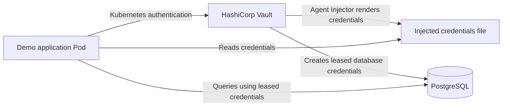

# Vault + Kubernetes + PostgreSQL Security Lab

A hands-on DevOps and cloud-security project using HashiCorp Vault,
Kubernetes, PostgreSQL, and Vault Agent Injector.

[](https://github.com/MicMichael246/vault-kubernetes-project/actions/workflows/ci.yml)

## Documentation

- [Architecture and Request Flow](docs/architecture.md)
- [Fresh Installation Guide](docs/fresh-install.md)

## Getting Started

### Prerequisites

- Linux shell with `kubectl`, `minikube`, `helm`, and Docker installed.
- A working Minikube cluster with enough resources for Vault, PostgreSQL, and the demo application.
- The repository files and the `vault-demo-app:1.1.0` image available to Minikube.
- Vault initialized and unsealed, with the required authentication, policies, secrets, and database secrets engine configured.
- The `database` namespace and `postgres-admin` Kubernetes Secret created before deploying PostgreSQL.

### Build the Demo Application Image

The demo application uses a local image named `vault-demo-app:1.1.0`. The Kubernetes Deployment uses `imagePullPolicy: Never`, so the image must be available inside Minikube.

Build the image directly in Minikube using the repository root as the build context:

```bash
minikube image build -t vault-demo-app:1.1.0 -f app/Dockerfile .
```

Verify that the image is available:

```bash
minikube image ls | grep vault-demo-app
```

For a fresh installation, build the image before deploying the application manifest. If the Deployment references a different image tag, keep the build tag and manifest tag consistent.


### Resume an Existing Lab

Start the existing Minikube cluster:

```bash
minikube start
kubectl get nodes
```

Check the Vault release and application Pods:

```bash
helm list -n vault
kubectl get pods -n vault
kubectl get pods -n database
kubectl get pods -l app=vault-demo-app
```

If Vault is sealed, unseal it using the securely stored unseal keys from the original initialization. Never store unseal keys or root tokens in this repository.

Once the application is running, expose it locally in a terminal:

```bash
kubectl port-forward svc/vault-demo-app 8082:8080
```

In a second terminal, verify the endpoints:

```bash
curl -s http://127.0.0.1:8082/health
curl -s http://127.0.0.1:8082/status
curl -s http://127.0.0.1:8082/db-check
```

The expected results are a healthy response, confirmation that the injected secret fields are present without revealing their values, and a successful read-only database check.

> **Important:** These instructions resume an existing lab; they do not constitute a complete fresh-install procedure. Vault initialization, Kubernetes authentication, database configuration, and secret creation must be completed separately.

## Architecture





- Kubernetes: Minikube
- Secrets management: HashiCorp Vault
- Database: PostgreSQL 16
- Deployment: Helm and Kubernetes manifests
- Authentication: Kubernetes ServiceAccount
- Secret delivery: Vault Agent Injector
- Dynamic credentials: Vault PostgreSQL database secrets engine

## Features Verified

### Kubernetes Authentication
A Kubernetes ServiceAccount authenticates to Vault and receives
permissions through a least-privilege Vault policy.

### Vault Agent Injector
An Nginx demo pod receives secrets in a rendered file.
Secret updates were verified without restarting the pod.

### PostgreSQL Dynamic Credentials
Vault generates temporary PostgreSQL credentials with a two-minute
default lease and a five-minute maximum lease.

Tests completed:
- Generated credentials successfully authenticated to PostgreSQL.
- The generated login successfully read the demo table.
- An INSERT attempt was denied.
- Revoking the Vault lease removed the generated database login.

## Repository Structure

- `docs/architecture.md` — Architecture diagram, request flow, and security boundaries
- `database/postgres.yaml` — PostgreSQL StatefulSet and Service
- `kubernetes/nginx-vault-demo.yaml` — Nginx Vault Agent demo
- `vault/policies/app-policy.hcl` — Vault access policy
- `vault/values.yaml` — Vault Helm configuration
- `app/` — Sample application, automated tests, and test runner

## Sample Application

The `vault-demo-app` sample application demonstrates:

- Reading a static KV v2 secret through Vault Agent injection.
- Rendering dynamic PostgreSQL credentials from Vault's database secrets engine.
- Connecting to PostgreSQL using the injected credentials.
- Health and status endpoints that do not expose secret values.
- A database check that runs a read-only query.
- A non-root application container with a read-only root filesystem,
  dropped Linux capabilities, and resource limits.

### Validation

The following checks have succeeded in the local lab:

- `/health` returns a healthy status.
- `/status` confirms that the injected secret file and required fields exist.
- `/db-check` successfully connects to PostgreSQL and reads the test row.
- Generated database credentials have been tested for read-only access.
- Revoking a test Vault lease removed its generated database login.

### Automated Tests

Run the application unit tests with `./app/test.sh`.

The current suite contains 9 tests covering secret-file status, health and database endpoints, error handling, generic 404 responses, and checks that fake credential values do not appear in HTTP responses. All 9 tests passed in the latest run. These unit tests do not replace end-to-end Vault and PostgreSQL security testing.


Run the application's unit tests before building the container image:

```bash
chmod +x app/test.sh
./app/test.sh
```

The script runs Python's built-in `unittest` test discovery against `app/tests`. It exits with a nonzero status if a test fails.

Alternatively, run the test suite directly:

```bash
python3 -m unittest discover -s app/tests -v
```

### Security Validation Results

The following checks passed in the local lab:

- All 9 application unit tests passed.
- Python test source compiled successfully.
- Vault capability checks returned `read` for the two intended paths and `deny` for an unrelated secret path and `sys/mounts`.
- The `app-policy` grants read access only to the static application configuration and dynamic database credential paths.
- PostgreSQL `app_readonly` is not a superuser and cannot create databases or roles.
- PostgreSQL privilege checks confirmed `CONNECT` and schema `USAGE`, but no schema `CREATE` privilege.
- PostgreSQL table privilege checks confirmed `SELECT` is allowed and `INSERT`, `UPDATE`, and `DELETE` are denied for `app_readonly` on `vault_demo`.
- Live `/health`, `/status`, and `/db-check` smoke tests succeeded; `/status` returns boolean indicators rather than credential values.

These checks are useful local-lab validation, not a complete production security audit. Dynamic credential renewal remains under investigation as documented below.

### Troubleshooting and Diagnostic Approach

This lab involved troubleshooting Vault Agent secret injection, dynamic PostgreSQL credentials, and lease behavior.

#### 1. Verify Kubernetes Workloads

Check the relevant Pods and their readiness before investigating application failures:

```bash
kubectl get pods -n vault
kubectl get pods -n database
kubectl get pods -l app=vault-demo-app
```

Confirm that Vault, PostgreSQL, and the application containers are running and ready.

#### 2. Verify Secret Injection Without Exposing Secrets

Inspect the application's health and status endpoints:

```bash
curl -s http://127.0.0.1:8082/health
curl -s http://127.0.0.1:8082/status
```

The status endpoint confirms that the expected secret fields are present without returning their values.

#### 3. Verify Database Access Controls

Test the application's database-check endpoint and separately validate database permissions. The intended database role can read the test data but must not be able to perform unauthorized write operations.

#### 4. Investigate the Lease TTL Warning

Vault Agent reported that the requested two-minute database credential TTL was being capped to an effective maximum of approximately 40–45 seconds. Diagnostic checks confirmed that direct Vault credential reads returned renewable leases with a 120-second TTL.

The database role, database secrets mount, and Kubernetes authentication role were inspected. Their configured TTL values did not explain the warning.

**Outcome:** The application and read-only database checks succeeded, but the TTL discrepancy remains unresolved. No unverified root cause or speculative configuration change is presented as a fix.

#### Troubleshooting Principles

- Check workload readiness before investigating higher-level failures.
- Verify secret presence without printing credential values.
- Test authorization boundaries, not only successful access.
- Compare observed behavior with effective configuration.
- Record unresolved issues honestly and avoid exposing credentials, tokens, unseal keys, or lease IDs.

### Known Issue: Vault Agent Lease TTL Warning

Vault Agent has logged warnings indicating that the requested 2-minute
database credential TTL is capped to an effective maximum of approximately
40–44 seconds, followed by a message that the renewer is done and the
dynamic credentials template is rendered again.

The Vault server and Agent both report version 2.0.4. Direct database
credential reads report a renewable lease with a 120-second TTL. The root
cause of the Agent warning has not yet been established.

The application and database check have succeeded despite this warning.
Further investigation is needed before treating dynamic credential renewal
as fully validated.

Do not include actual credentials, Vault tokens, unseal keys, or lease IDs
in documentation or diagnostic output.

Investigation also confirmed that the database role is configured with a 2-minute default TTL and a 5-minute maximum, the database mount maximum TTL is 768 hours, the Kubernetes auth role token TTL is 1 hour, and no explicit system-wide default or maximum lease TTL is configured. These settings do not explain the approximately 40–45-second effective TTL reported by Vault Agent. The cause remains unresolved; no speculative TTL changes have been applied.

### Recent Dynamic Credential Lifecycle Observations

During a follow-up local-lab test on 2026-10-28:

- Vault Agent rendered the dynamic database credential template multiple
  times while the application remained running.
- Vault Agent logs recorded a successful authentication-token renewal.
- The shortened effective TTL warning for database credentials continued
  after that authentication-token renewal; its root cause remains unknown.
- Vault server logs recorded database credential lease revocation events.
- The number of PostgreSQL roles matching the dynamic credential naming
  pattern decreased from two to one during observation.
- The application `/db-check` endpoint continued to return a successful
  database connection.
- The remaining matching PostgreSQL role had a future password expiration
  time at the time of the final role-count check.

These observations are consistent with ongoing credential refresh and
lease cleanup. However, the test did not correlate an individual Vault
lease ID with its corresponding PostgreSQL role, and did not establish
the cause of the Agent's shortened effective TTL warning. The dynamic
credential lifecycle is therefore partially validated, not conclusively
validated end to end.

Diagnostic evidence must not include passwords, Vault tokens, unseal keys,
or full lease IDs.

## Security Warning

This is a local learning lab, not a production deployment.
Vault TLS is disabled, and Vault runs in standalone mode.

Never commit passwords, tokens, unseal keys, or generated credentials.
Production deployments require TLS, hardened storage, backups,
appropriate access controls, monitoring, and security review.

## Planned Improvements

- Expand automated security tests and add integration-level security checks
- CI/CD and security scanning
- Monitoring and alerting
- Infrastructure automation

## Security Features and Limitations

### Security Features

- **Centralized secrets management:** HashiCorp Vault manages database credential generation and delivery.
- **Kubernetes authentication:** Workloads authenticate to Vault using Kubernetes ServiceAccount identity.
- **Dynamic database credentials:** Vault's PostgreSQL database secrets engine generates temporary database credentials with configurable leases.
- **Least-privilege access:** Vault policies restrict access to the secrets paths required by the application.
- **Credential injection:** Vault Agent Injector makes the required credentials available to the application through an injected file.
- **Sensitive-data handling:** Application tests verify that secret values are not exposed in relevant HTTP responses and error handling.
- **Automated testing:** GitHub Actions runs the Python unit tests on pushes and pull requests to `main`.

### Security Limitations

This repository is a local learning lab, not a production-ready deployment.

- **TLS:** The local demo may use HTTP for Vault communication. Production deployments should configure and validate TLS.
- **Vault initialization and unsealing:** Follow the documented initialization and unsealing procedure. Protect root tokens and unseal or recovery keys; never commit them to Git.
- **Database permissions:** Verify that the database account used by Vault has only the permissions required to manage the intended dynamic roles.
- **Credential lifecycle:** Configure and test lease expiration, renewal, and revocation behavior for the application’s use case.
- **Kubernetes hardening:** Production deployments should apply appropriate network policies, pod security controls, resource limits, and restricted RBAC.
- **High availability and recovery:** Production use requires an appropriate Vault storage, backup, recovery, monitoring, and availability strategy.
- **Configuration review:** Review example passwords, local settings, policies, and deployment manifests before adapting this lab for another environment.

**Important:** Do not commit Vault root tokens, unseal keys, real passwords, access tokens, private keys, or populated secret files to the repository.
