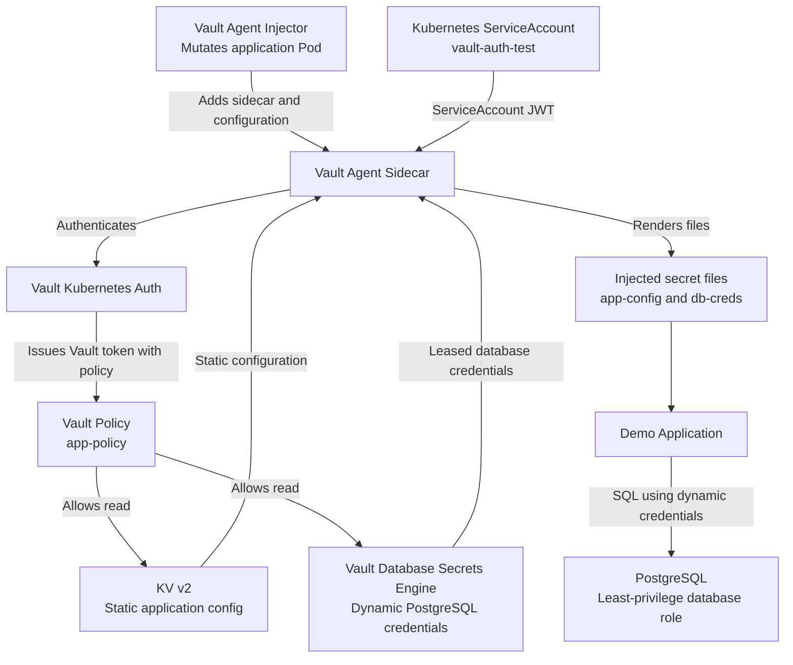

# Vault + Kubernetes Architecture

## Request flow

1. Kubernetes runs the application Pod with the `vault-auth-test` ServiceAccount.
2. The Vault Agent sidecar authenticates to Vault using Kubernetes authentication.
3. Vault policies authorize reads of the application configuration and dynamic database credentials.
4. Vault Agent renders the returned data into files shared with the application container.
5. The application reads the files and connects to PostgreSQL using the dynamic credentials.
6. PostgreSQL restricts the application to the intended read-only permissions.

## Security boundaries

- The application does not need to hardcode Vault tokens or database passwords.
- The Vault policy grants access only to the required secret paths.
- PostgreSQL permissions are restricted independently of Vault policy permissions.
- The application status endpoint reports credential-file presence without revealing secret values.

## Known limitation

Vault Agent has reported an unexplained effective TTL cap for the dynamic database credentials. See the README's **Known Issue: Vault Agent Lease TTL Warning** section. Successful database checks do not by themselves prove that lease renewal is fully validated.

## Environment warning

This is a local learning lab. Vault TLS is disabled and Vault uses standalone storage. Do not treat this configuration as production-ready.

## Verified Vault Configuration

The following settings were verified against the running Vault instance:

- **KV v2 secret path:** `secret/data/app/config`
- **Vault policy:** `app-policy`
- **Kubernetes authentication role:** `vault-auth-test`
- **Database connection name:** `postgres-database`
- **Database dynamic role:** `app-readonly`
- **Allowed database roles:** `app-readonly`
- **Database connection verification:** enabled
- **Default dynamic credential TTL:** 2 minutes
- **Maximum dynamic credential TTL:** 5 minutes

The database connection settings are stored under `connection_details` in the Vault database configuration. Connection values and credentials must not be committed to the repository.

The `app-policy` grants read access to the application configuration and the dynamic database credential endpoint. PostgreSQL independently enforces the database role's permissions.

## Troubleshooting and Diagnostic Approach

During configuration verification, the database connection was initially queried using an incorrect name. Listing `database/config` revealed the actual connection name, `postgres-database`. This illustrates why configuration should be inspected before attempting changes.

A further inspection showed that `connection_url` and `username` are nested inside `connection_details`, rather than being top-level fields. Checks that inspect only top-level fields can therefore incorrectly suggest that the connection settings are absent.

Troubleshooting principles:

1. List configured resource names before assuming their names.
2. Inspect field names and data types before inspecting configuration values.
3. Never print or commit database passwords, Vault tokens, or unseal keys.
4. Verify database access using the application health and database-check endpoints.
5. Investigate credential lease and renewal warnings separately from successful connectivity checks.

**Unresolved issue:** Vault Agent has reported an effective TTL cap for dynamic database credentials. This remains under investigation; no root cause has been confirmed.
